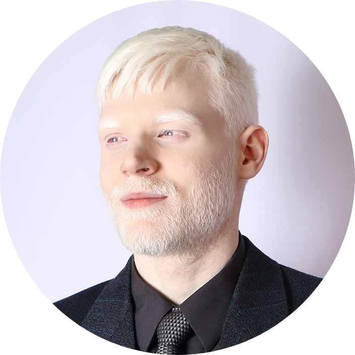

# Damon Blais &nbsp;·&nbsp; [@AlbinoGeek](https://github.com/AlbinoGeek)

**Principal software architect who writes the code &nbsp;·&nbsp; 90% blind albino technologist &nbsp;·&nbsp; Surrey, British Columbia**

Twenty years of programming, mostly Go and TypeScript on PostgreSQL, and the
distributed systems underneath them. I design a system, build it, and stay with
it through tests, CI and deploys. Self-taught.

Open to senior, staff and principal roles, remote from Canada.

Low vision is not a footnote here, it is working discipline: when the evidence is
insufficient, hold; when the tooling is inadequate, build better tooling. In
practice that reads as accessibility-forward product judgment and workflows built
to survive constraint.

### What I build

- **Services and data.** Go services over gRPC with mutual TLS, PostgreSQL schemas with row-level security proven by tests, job queues, replication and migrations.
- **Full-stack products.** React and Next.js in TypeScript, from the database schema to the interface, taken from zero to one as the sole developer.
- **Developer and AI tooling.** Tools that hold AI coding agents and people to the same test, lint and review gates, and local model infrastructure.

### In the open

- [rgit](https://github.com/Rethunk-Tech/rethunk-git-cli): commits a single function, method or type, in Go, using tree-sitter grammars cross-checked by language servers.
- [gate](https://github.com/Rethunk-Tech/rethunk-gate-cli): runs a project's test, lint, typecheck and build gates concurrently and passes the exit status through.
- [engined](https://github.com/Rethunk-Tech/engined): serves every local inference engine on one machine behind one OpenAI-compatible endpoint.
- [bakeoff](https://github.com/Rethunk-AI/bakeoff): benchmarks local LLMs head to head on quality, latency and cost.
- [Mortar](https://github.com/Rethunk-Tech/mortar): a desktop mod manager for PC games.
- Contributor to the [Fyne](https://github.com/fyne-io/fyne) Go GUI toolkit.

### Now

- **Rethunk.Tech**, Co-Founder and CTO. A hands-on role: architect of Bastion and IRONLAW, the Rethunk.AI product line for governing what AI agents do, and sole developer of Rethunk's current public product software and web systems, working alongside company leadership on strategy and go-to-market.
- **PeleOs Technologies**, Principal Software Architect. The software half of an orthopedic rehabilitation program, alongside clinicians and hardware engineers.
- **Albino Geek Services Ltd.**, Director. Canadian limited company, since 2012.

### Learning

Japanese (日本語) and German (Deutsch), in active study since 2026. English remains the only fluent one.

### Elsewhere

[LinkedIn](https://ca.linkedin.com/in/albinogeek)
&nbsp;·&nbsp; [Rethunk.Tech](https://we.rethunk.tech/)
&nbsp;·&nbsp; [PeleOs Technologies](https://peleostechnologies.com/)
&nbsp;·&nbsp; [@AlbinoStoic](https://twitter.com/AlbinoStoic)
&nbsp;·&nbsp; [damon.blais@gmail.com](mailto:damon.blais@gmail.com)

<!-- generated by https://github.com/lowlighter/metrics -->
<table align="center" width="100%">
<tbody>
  <tr>
    <td valign="top" width="50%">
      
      
    </td>
    <td valign="top" width="50%">
      
      
    </td>
  </tr>
</tbody>
</table>

Cards generated by [lowlighter/metrics](https://github.com/lowlighter/metrics).
